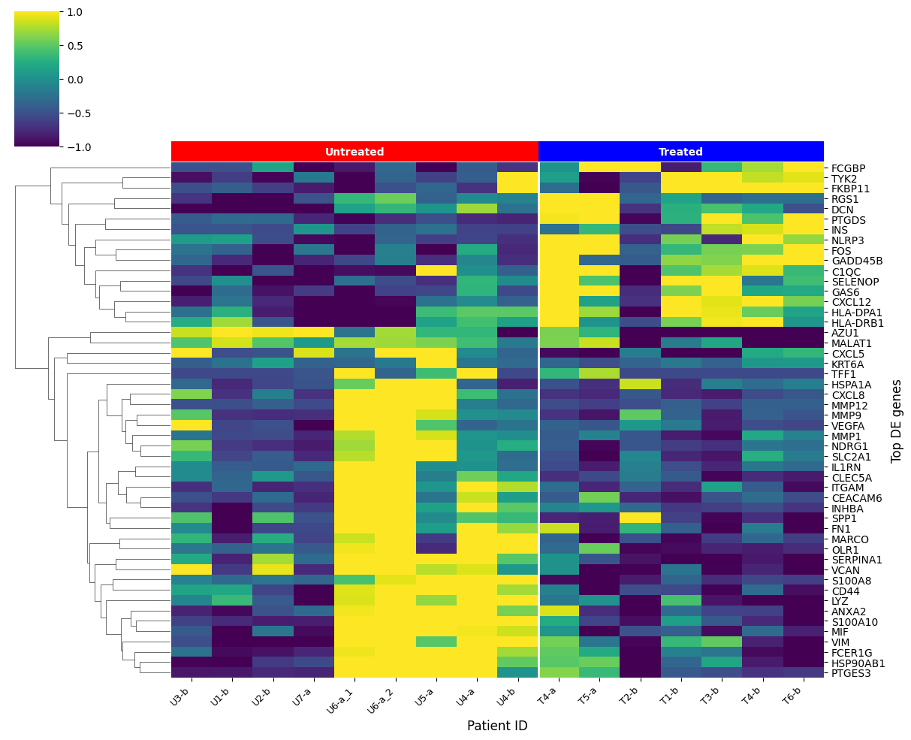
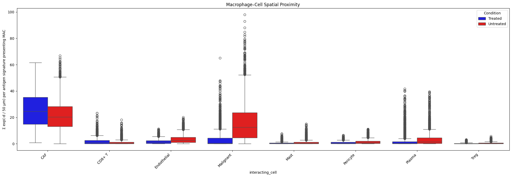
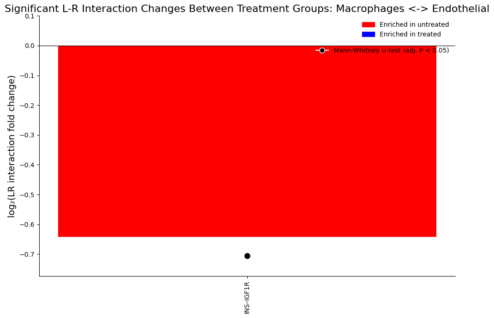

# Exploratory Data Analysis of Macrophage in PDAC

During my Cancer Research UK internship, I investigated how macrophages differed between treated and untreated pancreatic ductal adenocarcinoma (PDAC) tissue, and how macrophages with a treatment-associated gene signature were positioned relative to other cell types. Spatial transcriptomics made it possible to examine both gene expression and the arrangement of cells within the tissue.

I worked with a dataset containing **717,493 cells** and independently developed a Python analysis pipeline covering **differential gene expression, spatial proximity and ligand–receptor interactions**. I used Scanpy, LIANA and SCOTIA alongside my own functions for spatial calculations, data preparation and statistical comparisons.

I'm a mathematical physics student, and this project shows how I applied numerical programming to a biological research question: working with a large annotated dataset, translating spatial relationships into quantitative scores, and connecting the outputs of different scientific libraries.

**Start with the [cleaned notebook](MacrophagesAnalysisValidation.cleaned.ipynb). The original research notebook is retained locally and excluded from this repository.

[My contribution](#what-i-built) · [Analysis](#analysis-in-brief) · [Figures](#selected-figures) · [Limitations](#scientific-scope-and-limitations) · [Code and notebooks](#code-and-notebooks) · [Setup and tests](#run-the-lightweight-tests) · [Data](#data-and-optional-notebook-setup)

## What I built

I wrote the notebook workflow and the functions that joined its stages together:

- **Expression analysis:** I selected the macrophage population, organized the treatment comparison, filtered differential-expression results, and prepared sample-average expression heatmaps. Scanpy provided normalization, the Wilcoxon gene-ranking test and gene-signature scoring.
- **Spatial calculations:** I implemented an exponential proximity score by computing pairwise Euclidean distances within each sample and field of view, converting pixels to microns, and summing distance-dependent weights. NumPy and SciPy supplied the array operations and distance calculation.
- **Statistical comparisons:** I wrote functions for group-wise IQR filtering, assumption checks and comparisons between conditions, using SciPy's statistical tests and statsmodels' multiple-testing correction. These were applications of existing methods, not new statistical tests.
- **Ligand–receptor workflow:** I integrated LIANA's Connectome and CellPhoneDB methods with SCOTIA, then wrote the code to select candidate gene pairs, process output tables, summarize interaction scores and compare conditions. The interaction-inference methods themselves came from those libraries.

The original internship work is preserved in my local research notebook. A **later software refactor** moved selected functions into modules and added documentation and synthetic tests. Those checks verify selected code behavior; they do not constitute new biological validation or a rerun of the research.

## Analysis in brief

1. **Prepare macrophages.** Subset the annotated dataset, replace NaNs with zero, normalize each cell to 10,000 counts and apply `log1p`.
2. **Compare gene expression.** Use Scanpy's Wilcoxon workflow to compare treatment groups, select genes at adjusted p ≤ 0.05 and absolute log2 fold change ≥ 1, and visualize sample-average expression.
3. **Define a signature-selected population.** Score the genes upregulated in treated macrophages and select cells at or above the 90th score percentile within each treatment group.
4. **Measure spatial proximity.** Sum `exp(-distance_px × 0.18 / 50)` within each sample and field of view, then compare sample-level mean and median scores. The 50 µm parameter is a decay length, not a hard distance cutoff.
5. **Explore candidate communication.** Use LIANA to select ligand–receptor candidates, run SCOTIA by treatment, and compare detected field-of-view likelihoods using Mann–Whitney tests and Benjamini–Hochberg adjustment.

## Selected figures

These figures are taken directly from the saved outputs of my original notebook. No analysis was rerun and the images are unchanged.

### Differential gene expression



Macrophage expression for the top 50 genes selected after differential-expression filtering. Rows are genes and columns are samples, grouped by treatment. Colors show gene-wise z-scores of sample-average expression, with the displayed range limited to −1 to +1.

### Spatial proximity



Proximity scores from signature-selected macrophages to eight cell types, split by treatment. Each score sums exponential distance weights within the same sample and field of view, using a 50 µm decay length. The plot shows cell-level distributions; the statistical comparisons use sample-level summaries.

### Ligand–receptor interactions



Example SCOTIA output comparing predicted INS–IGF1R interaction scores between treated and untreated tissue. Results are exploratory; the original FOV-level comparisons do not account for patient-level dependence.

## Scientific scope and limitations

This is an exploratory analysis. The notebook's “Antigen signature presenting macrophages” label describes cells selected by a treatment-associated expression score; it is not an independently validated cell identity. Cells and fields of view from the same biological sample may not be independent observations, which limits the interpretation of the reported p-values. Inferred ligand–receptor interactions are predictions, not direct evidence of signaling or a causal treatment effect.

## Code and notebooks

- [Cleaned working notebook](MacrophagesAnalysisValidation.cleaned.ipynb): the published, output-free copy using the reusable helpers. Both execution flags default to `False`. The original notebook and its full saved outputs stay on my Mac.
- [Reusable Python code](pdac_macrophages): matrix preparation, spatial scoring, IQR filtering and ligand–receptor result handling.
- [Technical and scientific review](docs/REVIEW.md): known issues, preserved choices and the mapping between helpers and original notebook cells.
- [Change and validation record](docs/CHANGELOG.md): the files and checks from the later refactor, including 21 passing tests that run without the original notebook or dataset.

## Project layout

```text
MacrophagesAnalysisValidation.cleaned.ipynb # unexecuted refactored working copy
figures/                                  # unchanged figures from saved notebook outputs
pdac_macrophages/
    preprocessing.py                      # sparse NaN replacement and heatmap values
    spatial.py                            # original exponential proximity calculation
    statistics.py                         # original group-wise IQR filtering
    ligand_receptor.py                    # candidate lists, result loading and statistics
tests/test_helpers.py                     # self-contained synthetic and notebook checks
requirements.txt                          # lightweight helper dependencies
requirements-notebook.txt                 # optional analysis dependencies
docs/REVIEW.md
docs/CHANGELOG.md
.gitignore
```

## Run the lightweight tests

Use Python 3.11 or 3.12 and run commands from the repository root:

```bash
python3.12 -m venv .venv
source .venv/bin/activate
python -m pip install -r requirements.txt
python -m unittest discover -s tests -v
```

The tests use tiny synthetic tables and matrices. They do not open the `.h5ad` dataset or run normalization, differential expression, signature scoring, LIANA, or SCOTIA. Expected values come from small synthetic examples, including fixed statistical reference values recorded during the earlier helper comparisons. The original notebook is not required, and no analysis cells are executed.

<details>
<summary>Try a spatial calculation without the research dataset</summary>

Example of using a helper without the research dataset:

```python
from types import SimpleNamespace
import pandas as pd
from pdac_macrophages.spatial import exponential_model

obs = pd.DataFrame({
    "sample_id": ["demo", "demo"],
    "fov": [1, 1],
    "annotation_majortypes": ["Macrophage", "CAF"],
    "CenterX_local_px": [0.0, 3.0],
    "CenterY_local_px": [0.0, 4.0],
})
macrophage_scores, caf_scores = exponential_model(
    SimpleNamespace(obs=obs), "Macrophage", "CAF", radius=50
)
```

</details>

## Data and optional notebook setup

`raw_meta_data_final.h5ad` is a local research input of approximately 301 MB and is **excluded from Git**, together with every other `*.h5ad` file. The data file is not distributed in this repository.

The notebook's 717,493-cell count and sample labels match the pancreatic cancer spatial molecular imaging dataset described by **Shiau et al. (2024)**, [*Spatially resolved analysis of pancreatic cancer identifies therapy-associated remodeling of the tumor microenvironment*](https://doi.org/10.1038/s41588-024-01890-9), published in *Nature Genetics*. The authors provide the count matrix, metadata and cell-type annotations through the [PDAC-SMI and co-culture dataset on Mendeley Data, version 1](https://data.mendeley.com/datasets/kx6b69n3cb/1) (DOI: `10.17632/kx6b69n3cb.1`).

The published AnnData file is named `PDAC_raw_meta_data.h5ad`; the notebook uses `raw_meta_data_final.h5ad` and does not record any intervening preparation. The source citation identifies the matching published dataset without claiming that the two files are identical. Dataset reuse terms are provided with the public data record.

<details>
<summary>Expected input columns</summary>

The notebook expects an AnnData expression matrix with gene names in `var_names` and these `obs` columns:

| Column | Purpose |
| --- | --- |
| `annotation_majortypes` | Major cell types; categorical in the notebook |
| `annotation_subtypes` | Macrophage subtype labels |
| `sample_id` | Sample identifiers; categorical, with treatment inferred from `T` prefixes |
| `fov` | Field-of-view identifier within each sample |
| `CenterX_local_px`, `CenterY_local_px` | Local spatial coordinates in pixels |
| `CenterX_global_px`, `CenterY_global_px` | Global coordinates for exploratory summaries |

</details>

For authorized future analysis, install the additional dependencies with `python -m pip install -r requirements-notebook.txt`, launch `jupyter lab` from the repository root, and open the cleaned notebook. Configure `DATA_PATH` and `OUTPUT_ROOT` in the first code cell. `RUN_ANALYSIS = True` enables the analysis; `RUN_LR_ANALYSIS = True` separately enables the expensive interaction loop. Leave these disabled when reviewing. If intentionally running selected cells after a guard raises, dependency errors can occur because upstream variables have not been created.

The original analysis used Python 3.11.5 and the scotia_env environment. The reusable functions have been tested independently, but the complete notebook has not been rerun after refactoring. Reproducing the full analysis may require adjustments to dependency versions, particularly SCOTIA

## Reuse and provenance

The saved results come from the original internship notebook. The later refactor did not introduce new analysis methods or regenerate research results. No software or data license has been assigned because ownership and redistribution terms have not been established.
